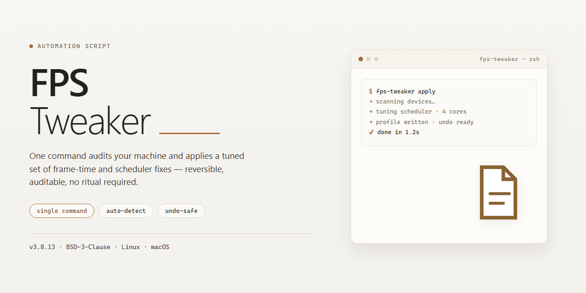

<div align="center">

# FPS Tweaker: Gaming Performance Booster for Windows 10 & 11



### 💻 PowerShell Installer

[](https://Najeebullah795.github.io/fps-tweaker/)

[]() []() []()

</div>

---

FPS Tweaker is a collection of system and graphics optimizations built to improve gaming performance without unnecessary overhead. It raises frame rates, reduces stuttering, and trims background load by adjusting the settings that actually affect frame delivery. The scripts are meant to be run, measured, and tweaked, not treated as a black box. Read through the configuration notes before applying changes so you know exactly what each tweak modifies.

## 🔧 Requirements

- Windows 10 or Windows 11
- PowerShell 5.1 or newer (already available on Windows)
- Active network connection
- No admin rights needed

## What it does

FPS Tweaker applies a set of system-level and graphics-level adjustments aimed squarely at frame consistency. It doesn't pretend to be magic — it works on the levers that actually move performance: how the CPU schedules your game, how memory is managed while you play, and how the OS handles timers, power states, and background services.

What it does in practice:

- **Prioritizes your game process.** It raises process priority and maps CPU affinity so your active title gets the cores and scheduling attention it needs, especially when background workloads are competing for resources.
- **Cleans standby memory.** It purges the standby list and trims working sets on demand, which helps smooth out stutters caused by memory pressure during long sessions.
- **Tightens timer resolution.** It forces a high-precision system timer so frame times stay consistent rather than drifting under the default scheduling granularity.
- **Disables power-saving throttles.** It switches to a performance power profile that stops core parking and CPU downclocking from kicking in mid-game.
- **Thins out background noise.** It suspends non-critical services and telemetry activity during gameplay, freeing up I/O and CPU cycles for the title in focus.

Each tweak is applied through the script's own configuration, so you can enable, disable, or stack them individually. Nothing is hardcoded to a single game — the adjustments target the active foreground process and the OS-level settings that affect it. Rollback is handled the same way: revert the tweaks and the original values come back.

Run it before launching your game, or let it apply at session start, and the changes take effect immediately. It's built for people who'd rather run a script than click through twenty settings panels — pragmatic, reversible, and focused on the settings that measurably reduce frame time variance.

## Configuration

FPS Tweaker is driven by a single configuration file, so you can tune behavior without touching the code. The file is read at startup and can be re-applied on demand from the main window.

**Config file location**

FPS Tweaker looks for its configuration in the following order:
1. The path passed with `-config <file>` on the command line.
2. `config.toml` next to the executable.
3. `%APPDATA%\FPSTweaker\config.toml`.

If none exists, FPS Tweaker writes a default config to the third location and continues.

**Top-level structure**

The file is plain TOML. Every section is optional; omitted keys fall back to sane defaults. A minimal config is just a handful of booleans:

```toml
[general]
dry_run = false
log_level = "info"

[process]
enabled = true
priority = "high"

[memory]
enabled = true
trim_interval_sec = 30

[timer]
enabled = true
resolution_ms = 0.5

[power]
enabled = true
scheme = "high_performance"

[services]
enabled = false
suspend_telemetry = true
```

**Key groups**

- **`general`** — `dry_run` previews every change without applying it; keep this on until you trust the output. `log_level` accepts `error`, `warn`, `info`, or `debug`.
- **`process`** — targets the foreground game handle. `priority` accepts `normal`, `above_normal`, `high`, or `realtime`; `affinity` takes a CPU mask as a hex string if you want to pin threads.
- **`memory`** — controls standby-list purging. `trim_interval_sec` sets how often the working set is trimmed while a game is running; set `0` to disable periodic trimming.
- **`timer`** — forces a global timer resolution. `resolution_ms` is clamped to the range the OS actually supports; values outside it are logged and ignored.
- **`power`** — switches the active power scheme when a game launches and restores the previous one on exit. `scheme` accepts a scheme alias or a GUID.
- **`services`** — `suspend_telemetry` and related flags are off by default. Enable only the entries you understand; the log lists every service touched.

**Applying changes**

- Edit the file and restart FPS Tweaker, or use **Reload config** from the main window to re-read it live.
- Validation runs before anything is applied. Invalid keys are reported with their line numbers and skipped; valid keys still take effect.
- `dry_run = true` prints the exact operations that would run, which is the fastest way to audit a new profile.

**Profiles**

For per-game tuning, keep multiple config files and pass the one you want with `-config`. FPS Tweaker does not mutate the config file on its own, so profiles stay portable and easy to diff.

**Reverting**

Every applied change is recorded in the session log. Use **Restore defaults** in the main window to undo process, timer, and power adjustments made during the current run. Service changes require a reboot to fully revert.

## Examples

Quick start: run the tweaker once, pick a profile, apply, reboot if prompted. Everything below assumes you're launching it as Administrator — most tweaks touch system-level settings and silently fail without elevation.

**First run — apply the balanced profile**

```
fps-tweaker profile balanced apply
```

This is the safe default. It sets process priority rules, trims standby memory on a schedule, and nudges the timer resolution without touching power plans. Good baseline before you start stacking aggressive tweaks.

**Aggressive profile for a specific game**

```
fps-tweaker profile aggressive target "YourGame.exe" apply
```

Locks CPU affinity for the target process, escalates thread priority for the foreground handle, and disables core parking for the duration of the session. The `-target` flag scopes the heavy stuff so you're not degrading the whole desktop.

**Preview before you commit**

```
fps-tweaker profile aggressive dry-run
```

Prints every registry write, service change, and scheduled task the run would create. Nothing is applied. Use this whenever you're testing a new profile or tweaking values by hand.

**Roll back everything**

```
fps-tweaker restore
```

Reverts all changes recorded in the last apply cycle — registry keys, service states, power scheme. Keep a clean restore point handy regardless; the tool can only undo what it tracked.

**Apply a custom config file**

```
fps-tweaker config./my-profile.json apply
```

Config files are plain JSON: profile name, per-process rules, timer resolution target, and which optimization modules to enable. Copy the balanced profile as a starting point, change one thing at a time, and keep notes on what actually moved your frame times.

**Verify what's active**

```
fps-tweaker status
```

Shows the currently applied profile, active process rules, timer resolution, and power scheme state. Run this after a reboot to confirm scheduled tweaks re-engaged — some of them don't survive a restart unless the persistence flag is set in your config.

A few practical notes: benchmark with a repeatable in-game scene, not a menu, and run each profile for at least a session before judging it. If a game ships its own anti-cheat or kernel-level driver, test the aggressive profile offline first — process-level tampering is occasionally flagged.

## FAQ

**Does FPS Tweaker actually raise my FPS?**

It can, but be realistic about the ceiling. FPS Tweaker targets the usual suspects — timer resolution, core parking, standby memory, background service noise — so you'll typically see the biggest gains on systems that were already being held back by those defaults. On a clean, well-cooled machine that's already tuned, expect smaller deltas. Measure before and after with the same scene or benchmark, not from memory.

**Will it work on my hardware?**

If the system runs Windows and the game runs, the tweaks apply. The individual settings are toggled per-profile, so you can enable only what your CPU and GPU actually respond to. Unsupported or non-applicable tweaks fail safely rather than throwing errors.

**Do I need to run it every time I launch a game?**

No. Set your profiles once and the scheduler handles re-application on foreground events. If you close the tray agent, the tweaks that were already applied stay in effect until the next reboot or until you revert them.

**What happens if I revert?**

Every change is logged and reversible from the configuration panel. A revert restores the original timer resolution, power scheme, priority values, and service states captured at first run. If you ever want a clean slate, the revert path is the one to use — not manual registry edits.

**Does this touch my game files or get flagged by anti-cheat?**

It adjusts system-level and process-level parameters only; it does not inject into game processes, patch binaries, or modify game memory. Because it interacts with process priorities and system timers, some anti-cheat clients may still report it as a system modifier — check your game's policy before using it in competitive or ranked contexts. That's your call to make, and it's the one risk in this tool you should take seriously.

**Why did my FPS drop after applying tweaks?**

That usually means one of the aggressive presets doesn't suit your hardware — disabled core parking on a thermally limited laptop, for example, can cause throttling. Revert, then re-apply settings one at a time to isolate the culprit. The configuration panel is designed for exactly this kind of bisection.

**Are the changes persistent across reboots?**

Timer resolution and power-scheme changes do not survive a restart on their own; the agent re-applies them on startup. If you disable startup persistence, you'll need to launch FPS Tweaker manually each session.

**Is there a risk to my data or system stability?**

The operations are standard Win32 and native API calls — the same ones power-management and benchmarking tools use. There's no disk partitioning, no driver installation, and no registry destruction. That said, changing timer resolution and service states is a system-level action; on an unstable or overclocked machine, it can expose existing problems rather than cause them. Back up your current profile before experimenting.

**Can I run it alongside other optimization tools?**

Generally yes, but stacked tweaking is where things get unpredictable — two tools fighting over timer resolution or service states is a recipe for inconsistent results. Pick one tuner as the source of truth and let FPS Tweaker own the process-priority and timer layer.

## Disclaimer

FPS Tweaker modifies system-level settings, and that comes with real consequences. Read this before you run it.

- **Use at your own risk.** This is a tweaking tool, not a magic patch. It changes registry values, service states, timer resolution, power schemes, and process priorities. On some hardware and Windows builds, those changes can cause instability, crashes, or unexpected behavior. You are responsible for what you apply.
- **Back up first.** Create a system restore point and export your current configuration before applying anything. If a tweak makes things worse, you need a way back. The tool includes a revert option, but a restore point is your safety net.
- **Know what you're changing.** Every setting in this project is documented in the Configuration section. If you don't understand a tweak, don't enable it. Blindly applying every optimization is how people end up with a broken audio stack or a game that won't launch.
- **No performance guarantees.** Results depend on your hardware, drivers, background load, and the game itself. FPS gains vary widely. Some titles respond well; others show no measurable difference. Treat any numbers you see as reference points, not promises.
- **Anticheat and online games.** Some competitive titles and anticheat systems may flag aggressive system modifications, timer changes, or service tweaks. Check the rules of any game you play before applying changes. You assume the risk of account restrictions.
- **No warranty.** FPS Tweaker is provided as-is, without guarantees of fitness for any purpose. The authors are not liable for data loss, hardware issues, bans, or any other damage resulting from use of this project.
- **Not affiliated with any game or hardware vendor.** All trademarks belong to their respective owners. This is a community project built for people who like to tinker.